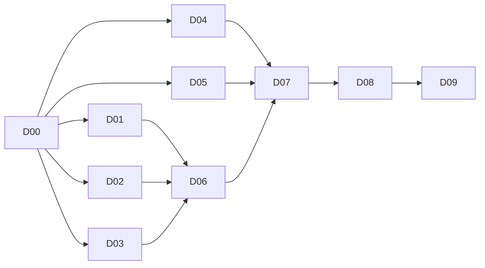

# 并发任务卡

任务卡是开发规格，不是生产授权。每张卡按“读输入→实现白名单文件→执行指定测试→提交交接”的顺序运行；任何跨白名单修改先交给协调者重新派发。目录均相对于“应用仓库”或“平台仓库”，两者不能混淆。

## 依赖图

D01–D05 可在无生产凭据的独立工作区并发开发。D03 可用契约夹具开发，直到 D06 才接入真实 D02 配置。外部环境输入缺失时仅完成 unit 子项，任务总状态保持 BLOCKED。D08、D09 不派给普通开发代理。

## D00：冻结决定与接口（协调者）

输入：README、contracts、总方案及用户已确认决定。写入范围：本任务包、私有 inventory、任务登记表；不写代码或控制面。

步骤：核对 contracts 决定表；就未决值向用户确认；登记测试环境资源由谁提供、谁授权建立；选定工具和运行版本精确值；为每任务分配唯一负责人和基线。无需外部资源即可冻结 CLI、文件命名与 JSON 契约 v1；开发者若发现不可实现必须退回 D00。

完成：契约接口字段完整，每个未决项具有负责人及阻塞任务；开发授权明确。生产授权不在此阶段发放。

## D01：应用镜像与变量清单

输入：契约 v1、当前 Dockerfile、两份 Next 配置、package/lockfile、源码 env 引用。文件所有权（应用）：`Dockerfile`、`.dockerignore`、`next.config.docker.mjs`、`next.config.mjs`、`config/env-manifest.json`、`scripts/deploy/app-smoke.mjs`、`tests/deploy/image.*`。

步骤：对比两份配置尤其 redirects/headers，保持公开路由行为；锁定支持的 Node/pnpm；排除环境文件与无关目录；生成变量阶段/必需条件清单；以 build secrets 处理必需秘密；非 root 镜像运行；提供只读 smoke，验证状态码之外的正文和资源。package/lockfile 修改由协调者统一合入，避免 D05 冲突。

完成：S01、S02 通过；交付生产/staging 分开构建方式、可写路径及版本清单。无真实环境凭据时集成部分 BLOCKED，禁止借用生产 token。

## D02：平台入口与隔离配置

输入：契约中的路径/命名/网络结构；D00 指定版本。文件所有权（平台）：`edge/`、`sites/`、`bootstrap/`、`config/`、`tests/platform/`；不修改 `bin/release`。

步骤：提供可重复初始化配置，不自动执行；Caddy 只发布网站端口，持久化证书状态；每站点独立网络；实现示例站点双版本并存；为 D03 输出渲染配置函数或模板及其参数说明，严格沿用契约；配置资源上限、日志轮转与重启策略。

完成：S03 通过（unit/隔离容器）；初始化与维护操作清单交给 D08，不连接生产部署。两个示例站点的资源名不能互相覆盖。

## D03：发布事务工具

输入：契约 CLI/锁/状态机；D02 未交付时使用约定结构夹具。文件所有权（平台）：`bin/preflight`、`bin/release`、`lib/release/`、`tests/release/`。

步骤：先用假 Docker/Caddy 适配器测试状态机；实现 request/approval 严格校验、digest 仓库白名单、锁和 generation；切流前后检查；断连恢复查询；最小权限启动器；候选失败清理仅作用于本 operation_id，磁盘清理不得删除活动/回滚镜像。生产启动器只接受固定配置与仓库白名单，不能接受任意 Compose 路径或 shell。

完成：S04 全部故障注入通过；开发者提交真实适配器测试方法，由 D06 集成验证，不能把模拟器通过当实际 Caddy 通过。

## D04：备份与时效告警

输入：契约、D00 选定存储/保留策略/密钥保管人，或仅 unit 假存储。文件所有权（平台）：`bin/backup`、`lib/backup/`、`backup/`、`tests/backup/`。

步骤：按数据覆盖时间记录恢复点；成功上传和校验之后更新状态；备份配置/秘密恢复包/证书和已存在持久数据，排除镜像缓存；默认恢复到隔离目录，恢复调度保持关闭；凭据与加密口令由指定保管人安全注入；实现过期与上传失败告警。无本机数据库时不安装数据库，仅定义后续适配接口。

完成：S07 unit 与获批异机集成部分通过；记录恢复用时、校验结果与存储占用。未选存储仍可交付 unit 实现，但总状态 BLOCKED。

## D05：支付与调度安全前置设计/实现

输入：现有 webhook、两条 cron、订单/条目 Schema；生产事件及邮件仅允许读脱敏样本。文件所有权（应用）：`src/app/api/webhook/route.ts`、`src/app/api/cron/`、必要 `src/data/` 新幂等模块、对应 Schema 及生成类型、`tests/deploy/side-effects.*`。平台调度文件由 D06 负责。

**D05a 是架构审查门禁，不能直接派给弱模型自行设计。** D05a 唯一写入范围为应用 `docs/deployment/side-effects-contract.md`，不改业务代码；D05b 只读该文档。指定较强的负责人先产出该契约：选定业务唯一键、原子履约边界、历史订单兼容、失败恢复状态、外部通知结果未知时处置、周报窗口/收件人账本、旧任务排空证据、最低安全回滚版本。由独立审查者通过后才派发 D05b 实现。

D05b 顺序：先写并发/部分失败测试；实现已批准状态机；Schema 变更后运行仓库 typegen，不手改生成类型；隔离数据集验证并发事件与部分发送重试；禁止把“发送已提交但响应丢失”自动当作可重发。

完成：S05 通过且安全回滚版本明确。若改造范围或费用超出用户授权，BLOCKED 回交协调者。D05a 未通过时其他独立开发仍可进行，但生产支付接流不得放行。

## D06：集成配置与 CI 交接

依赖：D01–D03 已审查交付。文件所有权（应用）：`.github/workflows/deploy.yml`、`.github/workflows/deploy-preview.yml`、新增镜像构建工作流；（平台）：`scheduler/`、`tests/integration/`。`AGENTS.md` 只由协调者在批准新流程后更新。

步骤：先增加不触发生产的镜像构建入口，使用候选 SHA 构建，不使用 `v*` 获取首个镜像；接通预检/prepare/status/promote；staging/production 分离 Secrets；旧 Preview 工作流有修改 production 变量的能力，交接时必须禁用该写入路径；生产新工作流先保持环境审批锁定；只在 D08 指令下冻结旧入口、核对在途/待执行 runs 并启用 VPS 唯一目标。

调度：保持每日 03:00 UTC 徽章、周一 09:00 UTC 周报；定义单站点调度所有权，候选和恢复默认禁用。开发防重不代表获准执行生产任务。

完成：S04 真实适配器、S06、S08 的隔离部分通过，发布模拟重跑不会调用 Vercel 或修改生产环境变量。此阶段不推生产 tag。

## D07：独立集成验收与操作附录生成

依赖：D04–D06 与其全部上游交付；测试环境与基线测量授权已提供。先按 S09 baseline 模式测量，再取得性能阈值批准并运行 acceptance 模式，未批准阈值时不能完成 D07。文件所有权（平台）：`bin/verify`、`tests/acceptance/`、`docs/operations-validated.md`；（应用）：`docs/deployment/vps-cutover.md`。不修改上游代码，缺陷退回文件所有者。

步骤：从干净环境按 contracts CLI 调用所有套件；补全 tests 中固定夹具，测量并提交容量阈值待用户批准；在隔离环境模拟首次部署、失败切流、回滚、恢复；生成操作附录，包含每步实际存在的命令、工作目录、输入清单路径、期望 JSON/退出码、超时、证据路径和失败处理。命令必须实际跑过，不能从猜测生成。

完成：S01–S09 应用到相应环境的结果齐全；没有以 NOT_RUN/N/A 掩盖必测项；附录标识测试过的精确提交/digest。只有一个新的独立代理照附录完成隔离演练，才判为“生产操作单可用”。

## D08：生产准备（唯一生产执行者）

依赖：D07 PASS、runbook 规定授权。输入：已验证操作附录、私有 inventory、授权单。仅使用已验证发布工具；DNS 及主机命令严格按附录执行。

完成：runbook P0–P4 证据及批准齐全。修改主机、防火墙/SSH、DNS 的权限分别确认。旧调度/工作流冻结证据缺失则停止，不从 402 推断已停。

## D09：切流与观察（同一生产执行者）

依赖：D08 PASS 和独立切流授权。执行 runbook P5–P7；任何失败先遵循登记的恢复动作，不自行扩大范围。

完成：线上只读冒烟、明确授权的最小写验收、发布目标审计、备份时效与观察窗口全部完成；未到下周周报窗口标为待验证，不能宣布该项完成。
