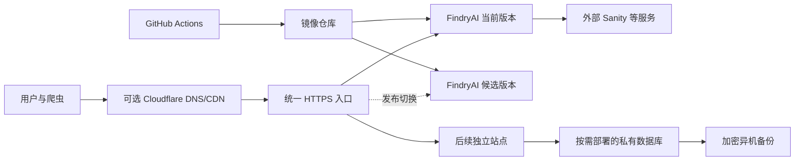

# 多站点 VPS 平台与 FindryAI 迁移方案

> 本文保留架构背景与历史决策，不再作为直接执行指令。AI 接手时先读 [迁移任务包入口](../migration/README.md)。任务划分、接口、测试与生产操作以该任务包为准；发现与本文冲突时停止并交给协调者确认，不自行择一执行。

## 状态与授权边界

本文为沟通草案，不代表授权安装、重启、修改 SSH、防火墙、DNS、生产流水线或购买服务。本轮只读检查了服务器及仓库，未执行迁移。后续需用户确认待决项和实施阶段。

仓库要求的 `openspec/AGENTS.md` 当前不存在，未凭空套用其规范。当前仓库存在无关未提交文件，实施时不得覆盖或纳入提交。

---

## 已确认需求

- R1：第一阶段仅迁移 FindryAI 应用，保留 Sanity 及现有外部支付、邮件、AI 服务。
- R2：服务器用于多个业务，KrillionClues 后续迁入；代码和技术栈暂未提供，不能承诺其容量或数据库兼容性。
- R3：保留 Git tag 触发 GitHub Actions 发布的使用方式，正式切换后目标为 VPS。
- R4：日常应用发布尽量无中断；不要求双机高可用，不承诺进行中请求全部成功。
- R5：未来本机持久数据的恢复点目标为 RPO 不超过 24 小时。
- R6：当前没有异机备份存储，需要推荐但不得自行购买。
- R7：通过版本化配置、镜像和异机数据备份，支持迁移到其他兼容服务器。
- R8：先规划并充分沟通，不直接开展迁移。
- R9：用户已确认使用 Caddy 作为统一入口，不同时部署 Nginx。
- R10：用户已确认基础设施配置放在 VastNext 下新建的独立私有仓库；建议名称为 site-infra，尚未创建，最终名称待确认。

---

## 巡检事实与容量结论

2026-11-23 通过用户指定的 SSH 密钥和本地 SOCKS 代理完成只读检查；installer 具有免密 sudo 权限。私钥不复制到服务器或 CI。

| 项目 | 实测 |
| --- | --- |
| 系统 | Ubuntu 24.04.1 LTS，x86_64，KVM |
| CPU | 4 vCPU，AMD EPYC 7571 型号标识 |
| 内存 | 5.8 GiB，总可用约 5.2 GiB |
| 磁盘 | 根分区 78 GB，可用约 74 GB |
| 当前运行情况 | 低负载，无 Docker 镜像、容器及卷 |
| Docker | 29.1.3，Compose 子命令不可用 |
| 公网监听 | SSH 22；未发现网站或数据库监听 |
| 安全与维护 | UFW inactive，密码认证开启，root SSH 禁止；无 swap；提示需要重启 |

结论：具备部署 FindryAI 和逐步接入轻量业务的基础资源，不等于已通过容量验收。未测磁盘性能、持续 CPU 性能、网络带宽、供应商流量额度或邻居争用。短时 CPU 空闲不能证明长期性能。

初始资源预算建议：为系统、代理和运维保留约 1 GiB；为 FindryAI 新旧版本并存预留约 2 GiB；剩余资源供未来业务与安全余量使用。该预算不是实测 RSS，也不是直接照抄的容器限制。限制值以启动、预热、SSR 和翻译并发的实测峰值确定。未来数据库接入必须重新核算发布峰值。

主机不可用内存持续低于 20%、出现 OOM、持续交换或 CPU 高负载时停止新增服务并评估扩容。容器限额提供隔离，不会创造额外容量。swap 仅作为故障缓冲，不能替代内存。

---

## 推荐架构

采用 Docker Compose，不采用 Kubernetes，不在第一阶段引入管理面板。平台配置放入 VastNext 下独立私有基础设施仓库，避免其他站点依赖 FindryAI 仓库；建议名称为 site-infra，尚未创建。以下平台文件路径均相对于该未来仓库。

这是一张用于审阅的方向图，不是要求逐字实现的配置。

- 公共入口只开放 80/443；应用端口与数据库端口不直接暴露公网。
- 每个站点独立 Compose project、配置、资源限制和私有网络。代理分别加入各站点入口网络，数据库留在站点内部网络。
- 公共代理已选定 Caddy，主要为了自动 HTTPS 和较少配置，不叠加 Nginx。持久化证书状态，管理 API 不暴露公网；验证配置重载时流式响应与 WebSocket 的排空行为，必要时设置延迟关闭。
- 不挂载 Docker socket 给网站或公共代理；应用使用非 root 用户，收紧可写目录与 Linux capabilities。
- 新站点按模板接入，不修改其他站点的启动配置。一个站点发布失败不得重启公共代理容器或其他业务；入口配置通过验证后进行平滑重载。
- 不为未来需求提前安装 PostgreSQL、MySQL 或 Redis。实际接入后按版本、隔离需求与资源决定是否共享数据库实例；即使共享也必须独立库、账号与备份。
- 统一主机参数、数据根目录参数、镜像引用和域名配置；业务代码中不绑定本机 IP。

替代方案：宿主机直接安装依赖初期简单，但多业务版本冲突和换机成本高；管理面板方便但增加控制面维护与攻击面，均不作为首选。

---

## FindryAI 适配边界

现有证据来自 `Dockerfile`、`next.config.mjs`、`package.json`、`.github/workflows/deploy.yml`、`src/sanity/lib/fetch.ts` 及项目说明。

- Dockerfile 使用 Node 20，并在构建时把 `next.config.docker.mjs` 移为 `next.config.mjs`；**现有 Docker 专用配置已经启用 standalone**，此前称 Docker 构建没有 standalone 是误判。普通 `next.config.mjs` 未启用，现有 CI 使用 Node 22。实施前验证两份配置的差异，统一受支持且兼容依赖的 Node 版本，并固定 pnpm 与镜像版本。
- 新增 `.dockerignore`；当前 `COPY . .` 不得把本地环境文件、Git 历史、截图缓存或私钥带入构建上下文。
- `NEXT_PUBLIC_*` 在构建时固化，同一正式域名换 IP 通常可以复用镜像，改域名或公开配置可能需要重新构建。
- 服务端密钥运行时注入。确需构建时访问 Sanity 的秘密通过 BuildKit secret 等临时机制传递，不通过 ARG、镜像层或构建日志泄漏；同时检查生成产物是否含不应公开的数据。
- 保留 `AUTH_SECRET` 等必要配置；核验可信代理头、应用公开地址和 NextAuth 主机信任，不能仅靠开启 trust host 掩盖错误转发。
- 初期正常流量仅进入一个应用版本，避免多副本 ISR 失效不同步。候选版本独立缓存，只进行有限公开页预热；切换后允许冷缓存重建。
- 候选预热后可能发生编辑或下架，不能认为候选缓存天然最新。每次切换**及回滚**必须在目标版本执行已验证的冷缓存接流或定向失效，再开放流量；短暂冻结后台写入仅是辅助条件，不能代替回滚目标的缓存清理。验证“预热后下架再切换”和“切换后编辑再回滚”，确保旧内容不复活。
- 不把旧版整个 `.next` 目录作为共享卷覆盖新版构建产物。缓存与业务数据区分：缓存可重建，不纳入关键数据备份；若需跨容器重启持久化，须验证具体可写路径、权限与版本隔离。
- 发布切换存在旧浏览器资源、RSC 和 Server Actions 的版本偏差。必须验证旧页面加载旧资源及提交行为；必要时短期保留版本资源，并提示刷新重试，不声称蓝绿天然解决该问题。
- 流式翻译需验证代理缓冲、超时和客户端断开；站点迁移不会取消 AI API 费用或第三方额度。
- 查明脚本、定时任务、Sanity webhook 和缓存刷新入口，防止只迁网页却遗漏运营任务。
- 已确认 `vercel.json` 定义两个定时任务：每日 03:00 UTC `/api/cron/check-badges` 和周一 09:00 UTC `/api/cron/pro-digest`；两者使用 `Authorization: Bearer CRON_SECRET`，后者会发送邮件。正式切换前设计 VPS 上的唯一调度器及重试/防重规则，候选环境不得执行真实任务；现存 Vercel 调度是否仍运行需在上线前核实。
- Stripe webhook 当前是先查询订单再创建，顺序重放不等于并发幂等；首次生产支付接流前，须实现基于事件或 Checkout Session 的持久防重机制并在隔离 Sanity 数据集中测试并发投递。周报同样须定义按发送窗口和收件人的持久发送记录或人工确认不自动重试；否则不得将“支付/邮件无重复”标为已验证。
- 不在第一阶段新增公共 HTML 代理缓存；先验证 Next ISR，再单独设计 Cloudflare 缓存键、Cookie、RSC 和失效策略。

---

## Git Tag 发布与回滚

建议镜像存放 GHCR，私有或公开属性由用户确认。镜像同时记录 tag 与 commit，实际部署固定 digest，不依赖浮动 latest。

发布状态：校验来源 → CI 构建及检查 → 推送镜像 → 服务器预检 → 启动候选 → 健康检查和冒烟 → 切换入口 → 外部验证 → 观察 → 清理过期版本。

- tag 必须指向批准的主分支提交；启用环境保护及最小 GitHub Token 权限，第三方 Actions 固定可信版本或提交。
- 同一站点发布串行化，使用主机侧锁防止 CI 重试、手工操作和其他运行相互覆盖；进入切换阶段后不得由新运行随意取消。
- 公共代理配置更新另设跨站点互斥，基于最新映射合并本站变更；回滚只能撤销本站对应发布，不得恢复整份历史配置而覆盖其他站点已成功的切换。测试两个站点同时发布及其中一个回滚。
- CI 构建，不在 VPS 编译。服务器拉取镜像时只配置只读仓库凭证；CI 使用独立部署密钥和固定主机指纹。
- 不把 installer 的无限 sudo 权限交给 CI。部署身份只允许调用受控、root 持有的站点发布入口；参数必须校验，部署身份不能任意改写 Compose 文件或执行 root shell。docker 组等价于高权限，不作为最小权限方案。
- SSH 可达性需从 GitHub 托管 runner 单独验证；用户本地的 127.0.0.1 代理不适用于 GitHub。若不允许公网部署 SSH，则另行选择受控隧道或拉取式部署，不直接安装高权限常驻 runner。
- 预检检查磁盘、内存、镜像可用性和当前版本；资源不足时停止，不影响旧版。
- 进程存活检查与依赖就绪检查分开，不能用健康探针高频访问昂贵 API。候选必须完成真实关键路径冒烟。
- 入口配置切换前验证语法并保存旧映射。切换后失败恢复旧映射；CI 断连后能够查询持久化发布状态并安全重试。
- 旧版本保留一段排空与观察窗口，具体时长结合最长流式请求确定；保留上一稳定镜像及配置供回滚，控制磁盘保留数量。
- 单次入口平滑重载和候选切换不等于严格零停机；旧连接、浏览器版本偏差及主机故障仍可能导致失败。
- 未来数据库变更采用向前兼容的扩展/收缩流程；应用回滚不等于数据库回滚，不能自动恢复旧备份覆盖新写入。

现有 `.github/workflows/deploy.yml` 及 `AGENTS.md` 明确约束 Vercel 生产与 Preview 流程，必须在用户确认迁移实施时一并更新。切换前不得使同一个生产 tag 同时触发两个目标。服务器候选域名验收作为新 Preview 门禁，验证通过且用户确认后才允许正式 DNS 切换。

---

## 安全、备份与可恢复性

### 主机基线

先核实供应商控制台救援能力、SSH 密钥有效性和服务商防火墙，再安排更新及重启。收紧 SSH 必须保留现有会话，并使用新会话验证成功后退出；不贸然关闭唯一可用通道。

仅暴露必要入口。Docker 发布端口可能绕过 UFW，必须同时验证 Docker 网络规则和外部扫描结果，不能以 UFW 状态作为验收。设置容器日志轮转、磁盘告警、定期安全更新和明确重启窗口。

### 异机存储建议

优先评估 S3 兼容对象存储配合成熟的客户端加密备份工具，例如 restic。候选为 Backblaze B2、Cloudflare R2 或其他独立对象存储；选择依据为实际区域、备份量、恢复下载费、保留策略和当前价格，不预设免费或固定费用。本阶段不开户、不购买。

独立供应商/账号的存储更能隔离 VPS 故障和账号事故。服务器备份凭证与备份清理权限尽可能分离；加密不能阻止持有删除权限的攻击者删除备份。对象锁或不可变保留需验证与备份工具清理策略兼容后启用。

### 备份策略草案

用户选择先估算再确定预算。2026-11-23 经代理读取官方定价：R2 Standard 为 0.015 美元/GB-month，账户含 10 GB-month 免费量、每月 100 万 Class A 和 1000 万 Class B 免费请求，直接出网不收费；B2 按量存储为 6.95 美元/TB/30 天，前 10 GB 免费，月出网免费量为月均存储的 3 倍，超出通常为 0.01 美元/GB。B2 常规 A/B/C API 调用免费，D 类另计。实际账单以供应商规则及账户已有用量为准。

以下为整月平均实际备份仓库占用量的存储费用估算，不是源数据大小；假设免费额度未被占用，不计税费及额外请求/下载费用。B2 按十进制 TB 换算。

| 备份仓库月均大小 | R2 Standard/月 | B2 按量/月 |
| --- | --- | --- |
| 10 GB | 0 美元 | 0 美元 |
| 50 GB | 0.60 美元 | 约 0.28 美元 |
| 100 GB | 1.35 美元 | 约 0.63 美元 |
| 300 GB | 4.35 美元 | 约 2.02 美元 |

长期保留和数据变化率决定仓库增长。数据库转储的压缩方式可能降低跨版本去重效果，不能保证 10 GB 数据库的长期备份仍只占 10 GB。现阶段仅配置与密钥通常较小，但尚未测量，Sanity 导出与未来上传文件须另估。每日检查全量备份可能产生额外下载量，校验频率必须纳入费用模型。

初步选择建议：少量数据且已有 Cloudflare 管理经验时，R2 Standard 操作集中、恢复出网费用明确；优先独立供应商隔离及较低存储单价时选择 B2。尚未选定或开通。

价格来源：https://developers.cloudflare.com/r2/pricing/ 、https://www.backblaze.com/cloud-storage/pricing 。

- 未来数据库建议每 12 小时生成数据库一致性备份并异机上传，给 24 小时 RPO 留出重试余量；数据库类型确定后选用相应工具。
- 持久上传文件与数据库引用需要协调备份时点；不能直接打包正在写入的数据库目录并当作一致性备份。
- 覆盖生产配置、密钥恢复包、数据、发布版本记录和必要证书状态；密钥加密保存且禁止进入 Git、镜像或日志。
- 保留策略初稿：14 天日备份、8 周周备份、6 个月月备份，按容量与预算确认。日志、缓存和可重拉取镜像不做常规数据备份。
- 备份成功必须包含上传与校验，监控最后成功恢复点；距成功备份超过 18 小时告警，超过 24 小时视为违反目标。告警渠道待确认。
- 恢复点年龄按已上传且校验通过的备份所覆盖的数据时刻计算，不按上传完成时刻计算；验证上传延迟、重试及连续失败不会错误刷新恢复点年龄。
- 加密恢复口令及对象存储恢复凭证必须在服务器之外保管，否则整机损坏后无法恢复。
- 首次切流前演练配置恢复与应用启动；接入本地数据库后演练真实数据恢复；此后定期抽样恢复，不能只检查备份任务退出码。
- Sanity 仍属外部依赖，其备份与可用性不自动包含在 VPS 数据备份内。建议后续确认 Sanity 导出备份策略，不能把保留 Sanity 等同于完整数据灾备。

### 换机流程

准备兼容 Linux x86_64 主机 → 应用基础配置 → 获取受控配置和密钥 → 拉取固定镜像 → 恢复持久数据 → 验证 HTTPS 与业务 → 暂停旧机写入并完成最终一致性同步（有本地数据时）→ 切换 DNS → 观察 → 关闭旧写入口 → 延后退役旧机。

当前规划不保证任意 CPU 架构都能直接运行；ARM 需多架构镜像及依赖验证。目标恢复时间 RTO 暂未确认，通过演练计时后制定，不承诺几分钟恢复。

---

## 实施单元与验收

平台路径相对于待创建的基础设施仓库；应用路径相对于当前 FindryAI 仓库。以下均未执行。

- [ ] U1. **平台配置与主机基线**

需求：R2、R7。依赖：用户确认代理方案、平台仓库及维护窗口。

文件：平台 `hosts/production.yml`、`bootstrap/`、`docs/host-recovery.md`、`tests/host-baseline.sh`。

方式：版本化幂等初始化，补 Compose，配置安全基线、日志和资源告警，不把业务数据库预装为全局依赖。

验收场景：重复初始化不破坏现有服务；新 SSH 会话正常；重启后入口自动恢复；公网无法访问应用和数据库端口；配置及日志无秘密。

- [ ] U2. **FindryAI 可重复镜像**

需求：R1、R7。依赖：U1 的运行约定。

文件：应用 `Dockerfile`、`.dockerignore`、`next.config.docker.mjs`、`next.config.mjs`（仅在需统一配置时）、`package.json`（仅必要工具链固定）、`scripts/deploy/smoke.mjs`。

方式：统一工具链、standalone、多阶段非 root 镜像，区分构建变量和运行变量，梳理读写路径。

验收场景：干净 checkout 可构建；镜像中无本地环境文件；首页、条目、分类、静态资源正常；条目连续访问命中 ISR；发布/编辑/下架触发正确缓存失效；只读路径约束不导致运行故障。

- [ ] U3. **入口与站点隔离**

需求：R2、R4。依赖：U1、U2。

文件：平台 `edge/compose.yaml`、`edge/` 下选定代理配置、`sites/findryai/compose.yaml`、`tests/site-isolation.sh`。

方式：独立网络、资源约束和候选域名；HTTPS 自动续期；正确代理头、流式响应及超时；不引入未经验证的公共 HTML 缓存。

验收场景：HTTPS 与重定向无循环；伪造 Host/转发头不突破可信入口；流式翻译分段到达；一个站点停止不影响另一个测试站点；证书续期路径可达。

- [ ] U4. **受控发布与回滚**

需求：R3、R4。依赖：U2、U3；确认 GitHub 到主机连通性。

文件：应用 `.github/workflows/deploy.yml`、`AGENTS.md`；平台 `deploy/`、`tests/deploy-lifecycle.sh`、`docs/release.md`。

方式：镜像 digest、最小权限身份、主机锁、持久化发布状态、候选验收、原子配置替换和平滑重载。

验收场景：候选启动失败不切换；切换后冒烟失败能回滚；两个 tag 不交错发布；断连重试不误删当前版本；镜像拉取失败与磁盘不足保留旧服务；旧浏览器资源与表单提交行为有明确处理；其他站点保持在线。

- [ ] U5. **备份与整机恢复演练**

需求：R5、R6、R7。依赖：用户选定异机存储、密钥保管方式及告警渠道。

文件：平台 `backup/`、`tests/backup-restore.sh`、`docs/disaster-recovery.md`。

方式：加密异机备份、恢复点监控、保留策略和隔离环境恢复；暂不虚构未知数据库的备份命令。

验收场景：服务器丢失后凭异机资料可恢复应用配置；错误凭证/上传失败触发告警；校验损坏备份被识别；恢复不访问生产写接口；记录恢复时间和遗漏项。数据库接入后必须补充数据库一致性恢复测试。

- [ ] U6. **生产切流与观察**

需求：R1、R3、R4。依赖：U1 至 U5 验收、用户批准切流。

文件：应用 `docs/deployment/vps-cutover.md`、`scripts/deploy/smoke.mjs`；平台发布记录。

方式：核实 DNS 控制权、源站 HTTPS 和 Cloudflare SSL 模式；候选环境受保护且 noindex；以测试账号验证认证与回调；支付验证使用测试模式，不产生真实收费。确认旧 Vercel 目标是否可用，不能将已停服目标当作有效回滚。

验收场景：首页/详情/搜索/登录/投稿/Studio/邮件/支付回调/翻译和运营刷新均按清单验证；规范 URL、robots、sitemap 不变；IPv4/IPv6 记录一致；切换后多网络探测正常；监控错误率、RSS、CPU、磁盘和缓存。生产写操作需单独授权。

观察建议为 24 至 48 小时，不因迁移完成立即删除旧配置。若旧 Vercel 仍不可用，回滚目标必须是 VPS 上稳定版本或备用主机，DNS 切回 Vercel 不构成恢复方案。

首次切流前必须实际建立并演练恢复路径，写明它能覆盖应用故障还是也能覆盖代理/主机故障。若没有备用主机，单机故障只能等待恢复，需用户明确接受这段停服风险；不能把尚不存在的“上一稳定版本”作为切流门禁已通过的依据。

---

## 可执行的首次迁移顺序（尚未执行）

每一阶段形成记录：执行人、开始/结束时间、镜像 digest、配置版本、验证结果与失败处理。**任一门禁未通过不得进入下一阶段；生产改动必须另获用户授权。**路径名称以最终基础设施仓库为准，不在公开仓库记录口令。

| 阶段 | 操作步骤 | 通过条件与留存证据 | 失败/停止策略 |
| --- | --- | --- | --- |
| 0. 冻结现状 | 盘点 DNS A/AAAA/CNAME、Cloudflare 代理/SSL/缓存规则及旧 Vercel 部署状态；核对 Stripe webhook URL、Sanity 预览/回调与 OAuth 回调允许列表；盘点两条 cron、站点脚本和环境变量**名称**。记录现有公开页面状态和实际可用的回退目标。 | 取得配置清单、旧站点基线、域名控制权和获授权的测试账号；明确哪些现有功能因 Vercel 402 暂不可测。 | 不修改 DNS；现有故障不能当作迁移验收基线。 |
| 1. 安全与容量门禁 | 核实 VPS 服务商控制台救援、带宽/流量/CPU 条款及快照；安排系统更新和重启窗口；安装 Compose、设置防火墙/外部安全组、SSH 救援方案、日志轮转和监控。 | 重启后 SSH 和 Docker 可用；从外部只见 22/80/443 中预期端口；具备镜像预热时双容器内存余量、无 OOM。 | SSH 新会话失败则恢复原配置；资源不足先升级 VPS，不削减安全余量硬上。 |
| 2. 建立可恢复平台 | 经用户确认后创建 VastNext 私有基础设施仓库，提交 Caddy/Compose/发布/备份**非秘密**配置；配置独立部署账号、镜像仓库只读拉取凭证、Caddy 证书持久卷及离线密钥恢复流程。 | 从空目录按文档重建入口和演示站点；Caddy 管理端口及业务内网端口外部不可见；已做隔离环境恢复演练。 | 凭证未妥善保管或恢复演练失败时不准备生产切流。 |
| 3. 构建应用镜像 | 先锁定生产提交，检查 `next.config.docker.mjs` 与常规配置的功能等价性；修复镜像上下文与版本固定；CI 对干净 checkout 运行只读检查和构建并推送 digest；扫描构建日志与镜像文件是否含密钥。 | 镜像在 CI 及目标 x86_64 运行成功；精确记录源提交、镜像 digest、构建时公开变量清单。 | 镜像构建失败不触碰服务器入口；任何泄密立即作废凭证和产物。 |
| 4. 受保护候选验证 | 在 VPS 上创建独立候选版本并配置必要运行时密钥，使用经验证的候选域名或受控 Host 映射；Caddy 获得有效 TLS，候选设置 noindex 且避免被搜索收录，尽量限制访问范围。模拟流量、缓存、OAuth、Sanity、邮件及支付测试环境。 | T01–T12、T14–T18 中可在隔离环境执行的场景通过；T13 切流前部分通过，T19 留待切流后；记录不能预先完成的测试及风险。监控候选并存时资源及延迟；公开 URL 不出现候选 canonical。 | 不做 DNS 切换；依测试结果修复并重新构建镜像。 |
| 5. 调度与外部回调准备 | 在 VPS 单独配置两条 UTC 定时任务，但保持禁用真实执行；从旧平台控制面取得旧定时器停用的证据，不能以 402 推断不会执行。逐一确认 Stripe endpoint 的事件订阅、签名密钥、OAuth/Sanity 回调域名；在隔离数据集证明并发 webhook 幂等、周报窗口/收件人去重或确定不自动重试。**相同公开 URL 原则上不需改 Stripe endpoint，仅需核实。** | 未授权请求被拒；旧调度已停、只有一套新调度可启用；写路径先完成隔离机制验证，线上最小生产验收另需授权。 | 旧调度无法证实停用则保持 VPS 调度关闭并记录可能漏发窗口；支付持久防重未验证则停止生产切流。 |
| 6. 首次切流门禁 | 确认备份、恢复演练、外部探测、最新健康状态、DNS TTL 及切流窗口；预先记录**精确 DNS 记录 ID、旧值、新值和批准人**。分别验证正式 Host 到源站的证书/入口，以及 Cloudflare 代理的完整请求路径，再允许修改记录。旧 Vercel 仍 402 时，明确应用级回退是 VPS 上经过验证的镜像，主机级风险需额外备用机器或用户明确接受停机。 | 用户对切流时间、业务写入风险、单机故障风险作单独确认；值班人与恢复凭据可用，正式域名证书与代理链路预检通过。 | 未确认则停止；不把 `vercel.app` 的 402 当作可用回退。 |
| 7. 切流 | 先完成正式 Host 的源站证书与入口预检，再**仅修改已批准的 DNS 记录**，按 DNS 实际记录处理 A/AAAA 与 Cloudflare 橙云；核对 Full (strict)，避免 Flexible 重定向循环。Caddy 入口指向已验版本；生产调度只在旧调度停用得到确认后启用。 | 从至少两条网络实际加载 HTTPS 首页和代表性深层链接；TLS、Host、页面 API、静态资源均通过；记录 DNS 传播和首轮监控。 | 应用故障切回 VPS 已验版本；代理/主机故障按真实恢复路径处理，不可盲目切回已停服 Vercel。 |
| 8. 观察与交接 | 连续观察 24–48 小时：错误率、支付 webhook 结果、cron 记录、内存与 OOM、CPU、磁盘、备份恢复点时间、ISR 命中、证书状态。按授权完成首次生产 tag 演练及回滚演练，更新运维手册。周报仅在下一次真实周一窗口核对，不能在 48 小时观察期内凭空视为已通过。 | 无未处理高危异常；tag 只部署 VPS；有签字的验收记录及恢复演练计时；尚未到期的 cron 项标为待验证。 | 异常则回到稳定镜像并保留日志/版本；不立即删除旧配置。 |

### 日常 tag 发布的动作与门禁

1. 验证 tag 所指提交来自获批准的主分支；生产环境保护审查通过。CI 运行 lint、build、镜像启动及静态密钥检查，然后推送固定 digest。
2. 主机领取该 digest，先检查健康、剩余内存/磁盘、当前发布锁与后端配置；保持当前容器接流，候选容器只接受隔离探针。
3. 运行只读应用冒烟和必要的低风险端到端测试；预热期间如发生内容变更，切换前重新失效候选缓存或以冷缓存接流。失败则删候选，不触碰入口。
4. 获取公共入口跨站点锁，从当前 Caddy 配置只修改本站映射、校验并平滑重载；更新持久化发布状态，保留旧版处理流式请求及版本资源。
5. 从外部探测本站，异常只回滚本站映射；观测排空窗口后停止旧容器。部署记录保留 digest、提交和回滚理由。测试并发两个站点发布不会覆盖映射。

---

## 测试用例矩阵（实施时写成自动化与人工验收记录）

这里的“通过”是未来执行标准，**不是已运行结果**。自动化优先使用隔离环境；读写 Sanity、Stripe、Resend 等外部生产系统的用例需经授权及安全测试数据。需先建立可重复的测试框架，本仓库目前没有正式测试套件。

| ID / 层级 | 前置条件与操作 | 预期结果 / 证据 |
| --- | --- | --- |
| T01 / CI | 干净 checkout、锁定依赖、无本地 `.env`，构建镜像并在只含公开构建变量时启动。 | standalone 的 `server.js` 正常监听；镜像构建版本与 Node/pnpm 锁定；构建所必需密钥若存在只用临时 secret。 |
| T02 / 安全 | 用 CI 生成的镜像检查文件层、镜像历史与构建日志；尝试直接访问应用 3000、数据库 5432、Caddy 管理端口。 | 无私钥或 `.env` 值；公网不可达内部端口，只有经 Caddy 的站点入口可用。 |
| T03 / 路由 | 候选环境 GET `/`、`/item/<已存在slug>`、`/category/<已存在slug>`、`/search`、`/robots.txt`、`/sitemap.xml` 及一份 `/_next/static/*` 资源。 | 正常页面及资源为预期状态码；搜索与 sitemap 内容可解析；canonical 始终是正式域名，不泄露候选域名。真实 slug 在基线阶段确定。 |
| T04 / 404 | GET 不存在的 item 与非法路径；检查请求头和错误页面。 | 正确返回 404，不显示密钥、堆栈或错误的 200/永久缓存。 |
| T05 / ISR | 首次访问同一条目，再重复访问；隔离环境中对该条目编辑/下架并触发失效。 | 首次生成后命中缓存且不持续回源；失效后内容更新/下架生效，不呈现过期内容。记录响应头和应用日志，不以耗时替代 CPU 数据。 |
| T06 / 蓝绿缓存 | 候选预热条目后更改或下架，再切换；切换后编辑条目再清理回滚目标缓存并回滚旧版本。 | 两个方向均不复活旧内容；如果无法证明回滚目标缓存已失效，不能回滚该版本。冻结编辑不能代替目标缓存清理。 |
| T07 / 登录与权限 | 测试账号尝试登录、退出、访问 `/dashboard`、匿名访问受保护页；验证 Google/GitHub 回调（仅已启用提供商）。 | 会话持久、重定向回正确正式域名、匿名被拦截、Cookie secure 属性和转发头可信。未启用提供商标记不适用。 |
| T08 / Sanity Studio | 授权账户打开 `/studio` 并执行只读操作；在测试数据集中尝试预览/草稿并退出。 | Studio 资源和登录正常，草稿不向公开页泄漏；非授权账户无法进入。生产内容写入不在冒烟中执行。 |
| T09 / Stripe 测试模式 | 使用 Stripe 测试事件与测试签名发至候选 endpoint，再发错误签名；另将同一 Checkout Session 的两个事件**并发**投递至隔离 Sanity 数据集。 | 有效事件只完成一次测试履约，顺序和并发重复投递均无二次订单或重复通知；无效签名被拒；生产 webhook 不用于候选写测试数据。若现有实现不通过，先实现持久防重再切流。 |
| T10 / 邮件 | 在非生产/测试收件箱触发重置或验证流程；记录 Resend 接收状态。 | 邮件链接指向正确域名、不会发给真实用户；错误凭证有告警且不泄密。 |
| T11 / 翻译流式 | 使用受控测试文本向 `/api/translate` 请求；观察首块与末块及断开连接。 | 内容正确分段抵达，Caddy 不错误缓冲或提前断流；超时与取消后资源释放，外部调用受预算约束。 |
| T12 / Cron 授权 | 不带或带错 `CRON_SECRET` 请求两条 cron endpoint；使用隔离数据集测试受权 dry-run（无 dry-run 时仅审查/增加安全测试模式），模拟周报部分收件人已发送后重试，并收集旧平台定时器停用证据。 | 未授权 401；候选不发送真实周报或修改生产 Sanity；同一窗口已发送收件人不重复发信（或明确禁用自动重试并记录人工处置）；正式环境只有一套调度器。 |
| T13 / DNS/TLS | 切流前记录目标 DNS 记录 ID/旧值/新值，验证正式域名 Host 在源站的 TLS/代理行为及 Cloudflare 完整路径；切流后分别从两条网络请求 HTTP 与 HTTPS。 | HTTPS 证书域名匹配、HTTP 正确跳转、Cloudflare Full (strict) 无循环；只修改批准的记录，A/AAAA 一致且无旧 IP 残留。 |
| T14 / 多站点隔离 | 演示站点与 FindryAI 同时运行，停止/发布演示站点并尝试访问 FindryAI。 | FindryAI 不重启、可访问；演示站点不能直接访问 FindryAI 私有网络/密钥。 |
| T15 / 发布失败 | 镜像不存在、候选健康失败、内存/磁盘不够、Caddy 配置无效，各注入一次故障。 | 发布失败并告警，旧容器继续接流；无部分切换、密钥或日志泄漏。 |
| T16 / 并发与回滚 | 同一站点双 tag 并发、不同站点并发、入口切换后 CI 断连、一次发布失败后回滚。 | 同站点串行且可恢复；不同站点配置不互相覆盖；回滚只影响本站；可查询最终 digest。 |
| T17 / 备份恢复 | 切断一轮上传、延迟一轮上传、损坏快照并在隔离主机恢复；记录快照覆盖的数据时刻。 | 18 小时预警、24 小时违约报警按数据时刻计；损坏备份不可假成功；恢复可启动且密钥仅来自异机。 |
| T18 / 容量与连续性 | 以脱敏代表性请求在候选环境重复访问首页/条目/API，模拟双版本和另一个轻量容器；观测一段时间及主机重启。 | 记录 p95 时延、CPU、RSS 峰值、OOM、磁盘与缓存命中基线；重启恢复 Caddy 与应用，实测资源不足则暂停切流并扩容。阈值依据基线与服务商指标评定。 |
| T19 / 发布后运营 | 首次生产 tag 及两条计划任务的下一次窗口，检查 webhook 投递记录、cron 日志与告警。 | tag 仅部署 VPS、不再触发 Vercel 生产；两个 cron 各执行一次且状态可追踪；Stripe 事件落库不重复。 |

**测试方式分层**：T01–T06、T12、T15–T17 优先写成 CI/平台脚本；T07–T11 在隔离环境及受控账号执行；T13、T18、T19 需真实网络/运行窗口，必须留存日期、环境和结果。隔离测试只证明机制，不能冒充生产写入已验收。经单独授权后对支付/定时写路径制定最小生产验收并收集第三方投递与 Sanity 结果；无法安全验证的路径保持禁用、人工观察或由风险负责人明确接受。失败用例修复后重跑相关依赖用例，不能以口头确认替代证据。

---

## 待确认事项与后续沟通

1. 公共入口已确认使用 Caddy；具体镜像版本、证书验证方式及排空参数在实施前核实。
2. 基础设施仓库归属已确认 VastNext，私有；最终名称及 GHCR 镜像可见性待确认。
3. 异机存储预算、备份加密口令保管方式、告警渠道。
4. 域名管理权限、候选域名、Cloudflare 现状及是否保留代理。
5. GitHub 部署 SSH 的网络准入策略，以及供应商救援控制台是否可用。
6. 主机更新与重启窗口；带宽、流量和持续 CPU 条款。
7. KrillionClues 技术栈、数据库、上传文件及定时任务，接入前单独评估。
8. RTO 目标、实际容量阈值与发布排空时间，结合演练确认。

下一轮确认备份存储与切流门禁。草案获批不等于授权立即修改生产；上面的测试用例不是已经通过的结果。

---

## 参考依据

- Next.js 14.2.35 自托管文档：https://github.com/vercel/next.js/blob/v14.2.35/docs/02-app/01-building-your-application/10-deploying/index.mdx
- Next.js 环境变量：https://github.com/vercel/next.js/blob/v14.2.35/docs/02-app/01-building-your-application/07-configuring/03-environment-variables.mdx
- Docker 防火墙限制：https://docs.docker.com/engine/network/packet-filtering-firewalls/
- Docker Compose 服务配置：https://docs.docker.com/reference/compose-file/services/
- Docker Compose 资源限制：https://docs.docker.com/reference/compose-file/deploy/

这些资料支持缓存、环境变量与网络隔离边界；Caddy、备份工具和对象存储的具体版本、权限能力及价格仍需在选择后核实。
