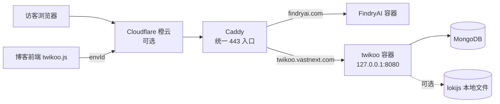

# Twikoo 评论系统迁移到 VPS 方案

> ## ⛔ 本方案已作废，不要执行
>
> **作废原因**：计划的前提错了。
>
> 调研中发现，Hexo 博客（`FountainChan/SourceHexoBlog` → `blog.vastnext.com`）的评论后端**不是** Vercel 上的 `twikoo_4_blog`，而是 Netlify：
>
> ```yaml
> # SourceHexoBlog/_config.anzhiyu.yml:371
> twikoo:
>   envId: https://delightful-haupia-ebcadd.netlify.app/.netlify/functions/twikoo
> ```
>
> 实测该后端**完全正常**，2026-11-25 复核：
>
> | 检查 | 结果 |
> | --- | --- |
> | `GET /` 健康页 | `200`，`{"code":100,"message":"Twikoo 云函数运行正常",...,"version":"1.7.14"}` |
> | `POST {"event":"GET_FUNC_VERSION"}` | `{"code":0,"version":{"VERSION":"1.7.14"}}` |
> | 评论读取 | `/tech/65164.html` 8 条、`/` 1 条，最新一条为 2026-11-24 |
>
> 也就是说：**博客评论从未因 Vercel 封禁而中断。** `twikoo_4_blog` 是早期部署的遗留项目，前端早已切到 Netlify，早就不在被引用的链路上。
>
> 用户决定：**不迁移**。本文件保留作为后续参考（其中的 CORS 规则、容器坑位、MongoDB 备份设计在将来真正需要自建时仍然有效），但 Phase 与待确认项**不再作为执行清单**。
>
> 将来什么情况下要重新启用本方案：Netlify 免费额度耗尽、需要对评论数据做完全自主掌控、或需要脱离第三方函数平台。届时先用本文件第 2.6 节和第 6 节，并重新核实版本（当前线上是 1.7.14，本方案写的是 2.0.17）。

> 以下是作废前的原始计划内容，未做删改。

文中 `UNSET` 表示必须先由用户确认才能执行，不得猜测、不得先用占位值跑通再说。
> 与 [多站点 VPS 平台与 FindryAI 迁移方案](2026-11-23-001-feat-multi-site-vps-migration-plan.md) 和 [迁移任务包](../migration/README.md) 共用同一台主机、同一个 Caddy 入口和同一套契约，冲突时以任务包为准。

## 0. 状态与授权边界

- 状态：**规划完成，等待确认项清零**。当前**未执行任何变更**。
- 本轮只做了只读核查：Vercel 项目配置、GitHub 仓库内容、npm/Docker 版本、Twikoo 官方文档、本机博客配置。
- 不授权事项：安装软件、开放防火墙、申请证书、修改 DNS、切换前端、删除 Vercel 项目。
- Vercel 侧 `twikoo_4_blog` 因团队 softBlock（`fluidCpuDuration` 超额）已 402，**回滚目标事实上不存在**，本迁移是单向的。这一点决定了后面的回滚策略。

---

## 1. 背景

团队 `fountainchans-projects`（Hobby）在 2026-11-18 00:11 因 Active CPU 超额被 Vercel 暂停，名下 5 个项目全部 `402 DEPLOYMENT_DISABLED`，其中包括评论后端 `twikoo_4_blog`。

FindryAI 已通过 Caddy 反代绕开 Vercel 恢复访问；`twikoo_4_blog` 没有做同类处理，目前：

```
https://twikoo4blog-inky.vercel.app  →  402 DEPLOYMENT_DISABLED
```

博客评论因此不可用。

## 2. 已核实现状

> **本节第 2.1–2.3 描述的是 Vercel 侧的历史部署，不是博客当前使用的后端。** 当前后端见顶部作废说明（Netlify，1.7.14）。以下内容保留，是因为将来真要自建时仍需要知道这些项目的历史。

### 2.1 Vercel 项目（历史部署，非当前后端）

| 项 | 值 | 来源 |
| --- | --- | --- |
| 项目名 | `twikoo_4_blog` | Vercel API |
| 项目 ID | 见私有清单（`prj_` 前缀） | Vercel API |
| 框架识别 | `null`（纯 JS 转发壳，无构建） | Vercel API |
| Node 版本 | 24.x | Vercel API |
| 生产分支 | `main` | Vercel API |
| 生产部署 | `twikoo4blog-jfpnyfsph-...vercel.app`，创建于 2026-07-19 | Vercel API |
| 别名 | `twikoo4blog-inky` / `twikoo4blog-fountainchans-projects` / `twikoo4blog-git-main-...` | Vercel API |
| 环境变量 | **仅** `MONGODB_URI`（sensitive，值不可读） | Vercel API |
| `live` | `false` | Vercel API |

### 2.2 源码仓库

`FountainChan/twikoo_4_blog`（私有），全仓库只有 4 个文件：

```
api/index.js        → module.exports = require('twikoo-vercel')
package.json        → { "dependencies": { "twikoo-vercel": "latest" } }
vercel.json         → 全量 rewrite: "/(.*)" → "api/index"
.github/dependabot.yml
```

**结论**：这是 Twikoo 官方 Vercel 模板 `templates/vercel-min` 的原样部署，源码里除了依赖声明没有任何业务逻辑、没有自定义路由、没有自建数据层。

### 2.3 运行时版本

> 注意：博客线上后端实际版本是 **1.7.14**（Netlify 部署），下表是 Vercel 侧 2.0.17 与 VPS 目标镜像的版本关系。若将来迁移，需要处理 1.x → 2.x 的跨大版本升级，不能假设数据格式完全一致。

| 组件 | 版本 | 说明 |
| --- | --- | --- |
| `twikoo-vercel`（当前后端） | 2.0.17 | Vercel 适配器，依赖 `mongodb@^7.6.0` |
| `tkserver`（VPS 后端） | 2.0.17 | 同一份服务端逻辑，bin = `tkserver` |
| `twikoo`（前端 SDK） | 2.0.17 | `dist/twikoo.min.js`，359 KB |
| `imaegoo/twikoo`（Docker 镜像） | `2.0.17` / `latest` | 76 MB，2026-10-22 更新，有 `arm32v7` 变体 |

三者版本号一致，说明 Twikoo 2.x 是「前端 / 服务端 / 适配器」同版本发布。**因此 VPS 端和现有 Vercel 端的数据格式完全一致，可以直接共用同一个数据库。**

### 2.4 已确认的能力与限制

Twikoo 私有部署（官方文档）：

- 环境变量全部可选，默认值如下表。
- 默认端口 `8080`，健康检查端点 `GET /ping`。
- 默认数据库是 **lokijs（本地文件 `./data`）**；传 `MONGODB_URI` 或 `MONGO_URL` 则改用 MongoDB。
- 健康检查：`GET /ping` 或 `GET /healthz`，返回 `{"code":0,"message":"pong"}`，**不查数据库**（数据库挂了也能反映进程存活）。
- 前端 `twikoo.js` 需 **≥ 1.6.0** 才支持私有部署。
- 管理面板就是后端域名本身（浏览器打开 → 首次设置密码），邮件、AI、限流、反垃圾都在面板里配。

#### CORS 规则（源码核实，`packages/server-common/src/core/pipeline.ts`）

不是「没有白名单」，而是有三级规则：

| 条件 | 行为 |
| --- | --- |
| Origin 是 `localhost` / `127.0.0.1` / `0.0.0.0`（可带端口） | 恒放行 |
| 配置项 `CORS_ALLOW_ORIGIN` 有值 | 按逗号分隔、去尾斜杠后**精确匹配**，不匹配则返回空 Origin 头，浏览器拒绝 |
| `CORS_ALLOW_ORIGIN` 为空 | 回显请求 Origin，即全放行 |

**迁移影响**：`CORS_ALLOW_ORIGIN` 存在数据库的 config 里，随数据库一起迁移，不需要重新配置。**但如果前端站点换域名，必须在管理面板同步更新这个值**，否则新域名被 CORS 拦截。

| 变量 | 默认 | 本方案取值 |
| --- | --- | --- |
| `MONGODB_URI` | `null`（用 lokijs） | 沿用现有连接串 |
| `MONGO_URL` | `null` | 不使用（与上重复，二选一） |
| `TWIKOO_PORT` | `8080` | `8080` |
| `TWIKOO_DATA` | `./data` | 保留（lokijs 兜底路径） |
| `TWIKOO_HOST` | `null` → 回退 `::` | 不设 |
| `TWIKOO_LOCALHOST_ONLY` | `null` | **不设**（见 5.3 的坑） |
| `TWIKOO_THROTTLE` | `250` | `1000` |
| `TWIKOO_LOG_LEVEL` | `info` | `info` |
| `TWIKOO_IP_HEADERS` | `[]` | `["headers.cf-connecting-ip"]` |
| `TWIKOO_MAX_BODY_BYTES` | `16777216` | 保留默认 |
| `TWIKOO_BODY_TIMEOUT_MS` | `15000` | 保留默认 |
| `TWIKOO_SHUTDOWN_TIMEOUT` | 由实现缺省 | 不设（优雅退出：关监听→排空→503） |
| `TWIKOO_REQ_TIMES_CLEAR_TIME` | `600000`（10 分钟） | 不设 |

### 2.5 目标主机（沿用既有实测，不重复探测）

来自多站点迁移方案的只读检查：

| 项 | 实测 |
| --- | --- |
| 系统 | Ubuntu 24.04.1 LTS，x86_64，KVM |
| CPU / 内存 | 4 vCPU / 5.8 GiB（可用约 5.2 GiB） |
| 磁盘 | 根分区 78 GB，可用约 74 GB |
| Docker | 29.1.3；**Compose 子命令不可用** |
| 入口 | 用户已确定统一使用 **Caddy**（FindryAI 已在其后） |
| 防火墙 | UFW inactive；SSH 22；root 禁止登录 |
| swap | 无 |

Twikoo 容器实测常驻内存约 200–400 MB（`jsdom` + `mongodb` 驱动是主要开销），在现有 5.2 GiB 可用内存下余量充足，但**必须与 FindryAI 一起核算总峰值**，不能只看单站点。

## 3. 待确认项（UNSET，清零前不得进入 Phase 2）

| 编号 | 待确认 | 为什么阻塞 | 怎么确认 |
| --- | --- | --- | --- |
| Q1 | `MONGODB_URI` 指向哪里（Atlas / 自建 / 其他） | 决定是「零迁移复用」还是「先迁移数据库」 | Vercel Dashboard → `twikoo_4_blog` → Settings → Environment Variables → 显示值 |
| Q2 | 前端站点是哪一个（哪个博客、哪个域名、哪个仓库） | 决定要改哪个 `envId`；找不到就不知道迁移是否成功 | 见 3.1 的三种定位法 |
| Q3 | 前端 `twikoo.js` 实际版本 | < 1.6.0 不支持私有部署，需先升级 SDK | 查主题配置里的 CDN 版本号，或 `grep twikoo` 前端产物 |
| Q4 | Caddy 是「宿主二进制」还是「容器」 | 决定反代上游写 `127.0.0.1:8080` 还是容器网络别名 | 主机 `systemctl status caddy` / `docker ps` |
| Q5 | 给 Twikoo 用哪个子域名 | 决定证书、DNS、前端 `envId` | 建议 `twikoo.vastnext.com`（`vastnext.com` 已在 Cloudflare，且 FindryAI/翻译器都在此域下） |
| Q6 | `vastnext.com` 当前是否仍走 Cloudflare 橙云 | 决定要不要加 `TWIKOO_IP_HEADERS` 和 CF 缓存规则 | DNS 查询 `A` 记录是否为 `104.x/172.6x` |
| Q7 | 是否允许在本机装 `docker-compose-plugin` | 现有 Docker 29.1.3 缺 Compose 子命令 | 用户授权，或改用 `docker run` + systemd（见 5.4） |
| Q8 | MongoDB 的备份现状 | Atlas 免费版备份能力有限；自建则完全没有 | Atlas 控制台 / `mongodump` 可用性 |

### 3.1 定位前端站点的三种方法

1. **从数据库反查**（最准）：拿到 Q1 的连接串后，按评论的 URL 聚合出站点域名。
   Twikoo 的 `config` 集合是**单文档**结构（`findOne({})`），不按站点拆分，所以站点信息只能从 `comment.url` 反推：
   ```bash
   mongosh "$MONGODB_URI" --quiet --eval '
     db.getCollection("comment").aggregate([
       { $group: {
           _id: { $arrayElemAt: [ { $split: ["$url", "/"] }, 2 ] },
           n: { $sum: 1 }
         } },
       { $sort: { n: -1 } }
     ]).forEach(r => print(r.n + " 条 -> " + r._id));
   '
   ```
   输出按域名倒序，评论最多的那个基本就是主站。

2. **本机搜索**：在所有博客/站点仓库里搜后端标识。
   ```bash
   grep -rn "twikoo4blog" --include=*.yml --include=*.yaml --include=*.json \
     --include=*.ejs --include=*.pug --include=*.html \
     D:/WorkDev G:/WorkDev 2>/dev/null | grep -v node_modules
   ```
   已确认：`D:/WorkDev/hexoNote/vastBlog`（Hexo + anzhiyu 主题）的 `themes/anzhiyu/_config.yml` 中 `twikoo.envId` 为**空**，`comments.use` 也是注释状态 —— **这个博客当前没有启用 Twikoo，不是本次的前端**。

3. **恢复后看面板**：VPS 部署好、数据连通后，打开管理面板即可看到各站点评论量，反推是哪个站。

## 4. 目标架构



要点：

- 只有 80/443 对外；Twikoo 只监听宿主回环，不暴露公网端口。
- Caddy 复用既有实例，新站只是多一段站点配置，不新增代理进程。
- 数据库优先复用现有 MongoDB；只有确认必须自建时才在 VPS 上起 mongod。
- 前端只改一个 `envId`，其余行为不变。

## 5. 实施阶段

### Phase 0 — 信息收集与备份（只读，约 15 分钟）

1. 在 Vercel Dashboard 抄下 `MONGODB_URI`，存进私有清单，**不写入仓库、不贴聊天**。
2. 记录当前评论总数，作为迁移后的比对基线：
   ```bash
   mongosh "$MONGODB_URI" --quiet --eval '
     db.getCollection("comment").countDocuments({})
   '
   ```
3. 导出一次全量备份（即使复用 Atlas 也要做，防止误操作）：
   ```bash
   mkdir -p ~/twikoo-backup/$(date +%F)
   mongodump --uri="$MONGODB_URI" --out ~/twikoo-backup/$(date +%F)
   ```
   若没有 `mongodump`，退而用 Twikoo 管理面板的「导出」功能（JSON），但需先能访问后端 —— 当前 402，只能走 mongodump 路线，或者临时把请求打到一个本地起的 `tkserver` 连同一库。
4. 确认 Q2/Q3/Q4/Q5/Q6/Q7/Q8。

**出口条件**：Q1、Q2、Q5、Q7 有明确值；备份文件存在且大小合理。

### Phase 1 — 数据库准备（按 Q1 分两条路，约 10 分钟）

**路线 A（推荐）：复用现有 MongoDB**

如果 Q1 是 `mongodb+srv://...mongodb.net/...`（Atlas）或任何可公网访问的 MongoDB：

- 不需要迁移数据，不需要在 VPS 装 MongoDB。
- 只需确认 VPS 出站能连通该集群（Atlas 需在 Network Access 里加上 VPS 公网 IP）。
- 验证连通：
  ```bash
  mongosh "$MONGODB_URI" --quiet --eval 'db.runCommand({ping:1})'
  ```
  期望 `{ ok: 1 }`。

**路线 B：在 VPS 自建 MongoDB**

仅当 Q1 指向 Vercel 内部/已失效地址时采用。

- 内存代价：mongod 常驻约 300–500 MB，会挤占 FindryAI 的预算，需在 Phase 1 结束时重新核算总内存。
- 用容器跑，数据目录挂宿主：
  ```bash
  docker run -d --name twikoo-mongo \
    --restart unless-stopped \
    -v /srv/twikoo/mongo:/data/db \
    -p 127.0.0.1:27017:27017 \
    mongo:7
  ```
- 把 Phase 0 的 dump 恢复进去：
  ```bash
  mongorestore --uri="mongodb://127.0.0.1:27017" ~/twikoo-backup/<日期>
  ```
- 此路线的新连接串为 `mongodb://127.0.0.1:27017/twikoo?directConnection=true`，容器内访问需用宿主内网地址或同网络别名。

**出口条件**：`ping` 通过；`comment` 集合计数与 Phase 0 基线一致。

### Phase 2 — VPS 部署 Twikoo（约 20 分钟）

2.1 建目录与配置（秘密文件权限 0600）：

```bash
sudo mkdir -p /srv/twikoo/data
sudo chown -R "$USER":"$USER" /srv/twikoo
cd /srv/twikoo
install -m 600 /dev/null .env
```

`.env` 内容（**值只写在服务器上**）：

```dotenv
MONGODB_URI=<Phase 1 确认的连接串>
TWIKOO_PORT=8080
TWIKOO_THROTTLE=1000
TWIKOO_LOG_LEVEL=info
TWIKOO_IP_HEADERS=["headers.cf-connecting-ip"]
```

> `TWIKOO_IP_HEADERS` 只在 Q6 确认前方有 Cloudflare 时设置。若不走 CF 却设了它，后端会采信可伪造的头，导致限流被绕过 —— 这是安全项，不是优化项。

2.2 启动容器

若 Q7 允许安装 Compose 插件：

```bash
sudo apt-get install -y docker-compose-plugin
```

`/srv/twikoo/compose.yml`：

```yaml
services:
  twikoo:
    image: imaegoo/twikoo:2.0.17
    container_name: twikoo
    restart: unless-stopped
    env_file: .env
    volumes:
      - ./data:/app/data
    ports:
      - "127.0.0.1:8080:8080"
    healthcheck:
      test: ["CMD", "wget", "-qO-", "http://127.0.0.1:8080/ping"]
      interval: 30s
      timeout: 5s
      retries: 3
      start_period: 20s
```

```bash
cd /srv/twikoo && docker compose up -d
```

若 Q7 不允许，用等价的 `docker run` + systemd unit（省略 `env_file` 时用 `--env-file`）：

```bash
docker run -d --name twikoo \
  --restart unless-stopped \
  --env-file /srv/twikoo/.env \
  -v /srv/twikoo/data:/app/data \
  -p 127.0.0.1:8080:8080 \
  --health-cmd 'wget -qO- http://127.0.0.1:8080/ping || exit 1' \
  --health-interval 30s \
  imaegoo/twikoo:2.0.17
```

**镜像锁定 `2.0.17`，不用 `latest`**：与现有 `twikoo-vercel@2.0.17` 严格对齐，避免自动升级带来数据兼容问题；升级另开变更。

2.3 本机验证

```bash
curl -s -o /dev/null -w '%{http_code}\n' http://127.0.0.1:8080/ping    # 期望 200
curl -s http://127.0.0.1:8080/ping                                     # 期望 {"code":0,"message":"pong"}
curl -s -o /dev/null -w '%{http_code}\n' http://127.0.0.1:8080/healthz # 同上（别名）
curl -s http://127.0.0.1:8080/ | head -c 200                            # 期望 Twikoo 状态页
docker logs --tail 30 twikoo                                            # 无连接错误
```

> `/ping` 与 `/healthz` 在源码里是**短路返回**，不查数据库。因此它能证明「进程活着」，但**不能证明数据库连通** —— 数据库是否就绪必须另外用 Phase 4 的接口验证。

**出口条件**：`/ping` 返回 200；日志里没有 MongoDB 连接失败；`docker inspect` 显示 `healthy`。

### Phase 2.5 — 关键坑位（必读）

| 坑 | 现象 | 正确做法 |
| --- | --- | --- |
| 在容器里设 `TWIKOO_LOCALHOST_ONLY=true` | 容器只监听 `127.0.0.1`，宿主端口映射失效，Caddy 永远 502 | 容器内监听 `0.0.0.0`（不设该变量），**用宿主端口绑定 `127.0.0.1:8080:8080` 收口** |
| 容器内连 `127.0.0.1:27017` 的宿主 MongoDB | 连的是容器自己 | 路线 B 用 `host.docker.internal`（加 `--add-host=host.docker.internal:host-gateway`）或同 compose 网络服务名 |
| 前面有 CF 但没设 `TWIKOO_IP_HEADERS` | 所有评论 IP 都是 CF 边缘 IP，限流误伤整站 | 设 `["headers.cf-connecting-ip"]` |
| 前面没 CF 却设了 `TWIKOO_IP_HEADERS` | 客户端可伪造 IP 绕过限流 | 不设；由 Caddy 传 `X-Real-IP` 并信任 |
| 用 `latest` 标签 | 自动升级可能跨小版本改数据结构 | 锁 `2.0.17` |
| 直接映射 `0.0.0.0:8080` | 后端管理面板暴露公网，可被暴力试密码 | 只绑 `127.0.0.1` |

### Phase 3 — Caddy 与 HTTPS（约 15 分钟）

3.1 DNS：为 `twikoo.vastnext.com` 添加记录

- 若 `vastnext.com` 在 Cloudflare 且已用橙云，新增 CNAME 指向主机，**先灰云**，等证书签发后再按既有流程切橙云（与 FindryAI 当初的时序一致，避免 525）。
- 若 Caddy 直接对外，A 记录指向 VPS 公网 IP 即可，Caddy 自动申请 Let's Encrypt。

3.2 Caddy 配置（宿主二进制场景）

在既有 Caddyfile 追加：

```caddyfile
twikoo.vastnext.com {
    encode zstd gzip

    # 管理面板与 API 都不需要缓存
    header {
        Cache-Control "no-store"
        -Server
    }

    reverse_proxy 127.0.0.1:8080 {
        header_up X-Real-IP {remote_host}
        header_up Host {host}
    }

    log {
        output file /var/log/caddy/twikoo.log {
            roll_size 10MiB
            roll_keep 5
        }
        format json
    }
}
```

Caddy 在容器场景时，上游写成容器网络别名 + 端口：

```caddyfile
reverse_proxy twikoo:8080
```

并把 twikoo 容器加入 Caddy 所在的外部网络。

3.3 校验与重载

```bash
sudo caddy validate --config /etc/caddy/Caddyfile
sudo systemctl reload caddy        # 或 docker exec caddy caddy reload
```

3.4 外部验证（**必须从公网打，不能只在本机 curl**）

```bash
curl -s -o /dev/null -w '%{http_code}\n' https://twikoo.vastnext.com/ping
curl -sI https://twikoo.vastnext.com | head -5
openssl s_client -connect twikoo.vastnext.com:443 -servername twikoo.vastnext.com </dev/null 2>/dev/null | grep -E 'subject=|Verify return code'
```

**出口条件**：公网 `/ping` 200；证书链完整；`Verify return code: 0`。

### Phase 4 — 数据与功能校验（约 20 分钟）

4.1 打开 `https://twikoo.vastnext.com` → 设置管理员密码（若数据库里已有 `ADMIN_PASS`，则用原密码登录，**不要覆盖**）。

4.2 逐项核对：

| 检查 | 期望 |
| --- | --- |
| 面板能列出站点 | 站点数量与迁移前一致，能反推出 Q2 的答案 |
| 评论总数 | 与 Phase 0 基线一致 |
| 最近 5 条评论 | 内容、时间、昵称、头像 URL 均正常 |
| 邮件通知配置 | 发信渠道、密钥仍在（配置存在 MongoDB 里，随库迁移） |
| **`CORS_ALLOW_ORIGIN`** | 值随库迁移；若为空则全放行；若有值，逐条核对前端域名是否在列 |
| 限流生效 | 连续快速请求返回 429（不是 200 + 错误码） |
| IP 属地 | 显示真实访客 IP 的属地，不是 CF 边缘 IP |

`CORS_ALLOW_ORIGIN` 可以直接从库里查，不用翻面板（注意 `config` 是单文档，字段在顶层）：

```bash
mongosh "$MONGODB_URI" --quiet --eval '
  const d = db.getCollection("config").findOne({}) || {};
  print("SITE_NAME        =", d.SITE_NAME || "(空)");
  print("CORS_ALLOW_ORIGIN =", d.CORS_ALLOW_ORIGIN || "(未配置，全放行)");
'
```

4.3 用 API 做一次读操作冒烟（不需要前端）：

```bash
curl -s -X POST https://twikoo.vastnext.com \
  -H 'Content-Type: application/json' \
  -d '{"event":"GET_FUNC_VERSION"}' | head -c 200
```

期望返回版本号 `2.0.17`。

**出口条件**：4.2 全部通过；4.3 返回版本号。

### Phase 5 — 前端切换（约 10 分钟 + 一次发布）

5.1 确认 `twikoo.js` 版本 ≥ 1.6.0（Q3）。anzhiyu/Butterfly 类主题通常在 `_config.yml` 的 `asset.twikoo` 或 `CDN` 段指定版本；低于 1.6.0 先升级。

5.2 把后端地址写进主题配置（以 anzhiyu 为例，`themes/anzhiyu/_config.yml`）：

```yaml
comments:
  use: Twikoo

twikoo:
  envId: https://twikoo.vastnext.com
  region:          # 私有部署留空，仅腾讯云环境需要
  visitor: false   # 需要文章访问量统计时改 true
  option:
```

5.3 发布博客，并在**真实浏览器**里验证（不是 curl）：

- 打开一篇文章 → 评论区正常渲染
- 发一条测试评论 → 立即出现在列表
- 刷新 → 评论仍在（说明写库成功）
- 到 `https://twikoo.vastnext.com` 管理面板 → 能看到这条评论并删除
- 检查该评论的 IP 属地是否正确

5.4 多站点场景：如果 Q2 发现不止一个前端，**逐个改、逐个验**，不要一次全切。

**出口条件**：三端一致（前端显示 / 后端面板 / 数据库计数）。

### Phase 6 — 观察与收尾（7 天观察期）

| 时间 | 动作 |
| --- | --- |
| 切换当天 | 记录内存/CPU 基线（`docker stats twikoo`） |
| D+1 | 核对评论数增量、日志无 5xx |
| D+3 | 复核 IP 属地与限流；检查磁盘增长 |
| D+7 | 确认稳定后，Vercel 项目设为保留但不再引用（**不删除**，因为账户被封，删除操作本身有风险） |

收尾时更新私有清单：新后端地址、镜像 digest、配置哈希、备份位置。

## 6. 数据迁移的两种情形对照

| | 路线 A：复用现有 MongoDB | 路线 B：VPS 自建 MongoDB |
| --- | --- | --- |
| 数据搬运 | 无 | `mongodump` → `mongorestore` |
| 停机窗口 | 0（两套后端可短暂并行） | 需要，约 10–20 分钟 |
| VPS 内存占用 | 0 | +300–500 MB |
| 备份责任 | Atlas 侧（需确认免费档能力） | 自己，必须加 cron |
| 风险 | 依赖外网数据库连通性 | 单点，mongod 挂了评论全挂 |
| 推荐度 | ★★★★★ | ★★☆☆☆（仅当原库不可用） |

若走路线 B，备份用宿主 cron：

```cron
15 3 * * * mongodump --uri="mongodb://127.0.0.1:27017/twikoo" --archive=/srv/twikoo/backup/$(date +\%F).gz --gzip
```

并加保留策略（例如 14 天），以及**异机副本**（写进既有任务包的备份要求）。

## 7. 回滚方案

**事实前提**：Vercel 侧 402 已持续一周，团队处于 Hobby softBlock，`unpauseAt = 2026-12-18`，且官方文档明确「Hobby 团队暂停后不会在期满时自动恢复」。**因此不存在可用的 Vercel 回滚目标。**

在给定事实下的回滚策略按层级：

| 故障 | 回滚动作 | 恢复时间 |
| --- | --- | --- |
| 前端改错 `envId` | 改回上一值并重新发布博客 | 5 分钟 |
| Twikoo 容器异常 | `docker restart twikoo`，仍失败则回上一镜像 digest | 2–10 分钟 |
| Caddy 配置错误 | `caddy validate` 不通过则不 reload，保持旧配置 | 0（未生效） |
| 数据库误写 | 从 Phase 0 的 dump 恢复到新库，切换 `MONGODB_URI` | 20–40 分钟 |
| 整机故障 | 按既有任务包的异机恢复流程（依赖 Q8 的备份是否到位） | 视备份而定 |

单站点回滚不涉及 DNS；只有整机迁移才动 DNS，按任务包的「生产执行者独占」规则执行。

## 8. 验收清单

Phase 5 完成后，以下全部为「是」才算迁移完成：

- [ ] 公网 `https://twikoo.<域名>/ping` 返回 200
- [ ] 证书由可信 CA 签发，`Verify return code: 0`
- [ ] 容器状态 `healthy`，`restart` 策略为 `unless-stopped`
- [ ] 后端端口仅绑定 `127.0.0.1`，公网不可直连
- [ ] 管理面板可登录，能按评论 URL 看到与迁移前一致的站点分布
- [ ] 评论总数与基线一致
- [ ] 前端可正常发评论、刷新后仍在、面板可见、可删除
- [ ] `CORS_ALLOW_ORIGIN` 核对通过（为空或包含前端域名）
- [ ] IP 属地显示真实访客 IP
- [ ] 限流生效
- [ ] 邮件通知（若启用）能发出
- [ ] 日志无持续 5xx
- [ ] 备份任务已配置且首次执行成功
- [ ] 私有清单已更新（地址、镜像 digest、配置哈希、备份路径）

## 9. 风险登记

| 编号 | 风险 | 影响 | 缓解 |
| --- | --- | --- | --- |
| K1 | Q1 的库不可公网访问（例如绑定 Vercel 内网） | 只能走路线 B，工作量翻倍 | Phase 0 先测连通，再决定路线 |
| K2 | 找不到前端站点（Q2 未定） | 迁移「完成」但业务无感知 | 用 3.1 的数据库反查法；未定前不宣布完成 |
| K3 | 与 FindryAI 争内存 | 5.2 GiB 被挤爆，OOM | 部署后跑 `docker stats` 实测，设容器内存上限 |
| K4 | Cloudflare 橙云 + 证书时序错误 | 525 / 重定向循环 | 沿用「先灰云签证书，再切橙云」的既有流程 |
| K5 | 管理面板暴力破解 | 评论被清空/篡改 | 强密码；可加 Caddy `basic_auth` 或 IP 白名单到 `/admin` 路径 |
| K6 | 镜像用 `latest` | 自动跨版本升级 | 锁 `2.0.17`，升级单独变更 |
| K7 | 无 swap | 内存突增时直接 OOM kill | 与任务包一致：加 swap 只作故障缓冲，容量问题靠限额和扩容 |
| K8 | Twikoo 2.x 的 AI/反垃圾依赖外部 API | 未配置则相关功能不可用 | 迁移后在面板复核配置，不在本次范围内新增 |
| K9 | `CORS_ALLOW_ORIGIN` 白名单不含前端域名 | 评论框静默失败（控制台 CORS 报错），后端日志无异常 | Phase 4 先查该字段；前端换域名时同步更新 |
| K10 | 误把 `/ping` 200 当作迁移成功 | 进程活着但数据库不可用，发评论全失败 | 必须另做 Phase 4 的写读验证，`/ping` 只算一半 |

## 10. 工作量估算

| 阶段 | 路线 A（复用库） | 路线 B（自建库） |
| --- | --- | --- |
| Phase 0 信息与备份 | 15 min | 15 min |
| Phase 1 数据库 | 10 min | 40 min |
| Phase 2 部署 | 20 min | 20 min |
| Phase 3 Caddy/HTTPS | 15 min | 15 min |
| Phase 4 校验 | 20 min | 20 min |
| Phase 5 前端切换 | 10 min + 发布 | 10 min + 发布 |
| Phase 6 观察 | 7 天（被动） | 7 天（被动） |
| **合计（主动操作）** | **约 1.5 小时** | **约 2 小时** |

## 11. 与既有迁移任务包的关系

- 本计划覆盖的只是「一个轻量后端服务」，**不新增主机、不新增代理进程、不改 DNS 解析体系**，因此比 FindryAI 迁移简单得多。
- 但以下规则仍然继承任务包，不可简化：
  - 生产写入由**唯一执行者**完成，多人并发只允许改文档和本地代码。
  - 秘密不进 Git、不进聊天、不进日志；只在服务器 `0600` 文件里。
  - `UNSET` 一律 BLOCKED，不允许先猜一个值跑通。
  - 证据落在私有 `evidence/` 目录，Git 只提交脱敏摘要。
  - Caddy 配置加载成功 ≠ 后端健康，必须另做公网验证。
- 如果用户希望按 `docs/migration/` 的完整任务包格式（README / contracts / tasks / verification / runbook 五件套）执行，本文件可直接拆成 `docs/migration/twikoo/` 下的五个文件；技能标签沿用 `TK-` 前缀。

## 12. 最小可行路径（如果只想最快恢复评论）

如果不在乎规范性、只想今天恢复评论功能，按以下顺序做，其余全部跳过：

1. 拿到 `MONGODB_URI`（Q1）。
2. VPS 上 `docker run` 起 `imaegoo/twikoo:2.0.17`，绑 `127.0.0.1:8080`。
3. 本机 `curl http://127.0.0.1:8080/ping` 确认 200。
4. Caddyfile 加 `twikoo.vastnext.com { reverse_proxy 127.0.0.1:8080 }`，reload。
5. 改前端 `envId`，发一篇测试评论。

大约 30 分钟。**但不做 Phase 0 备份、不做 Phase 4 计数比对、不设 `TWIKOO_IP_HEADERS`，就相当于在没有安全网的情况下动生产数据** —— 是否接受由用户决定，本文件不代替该决定。
